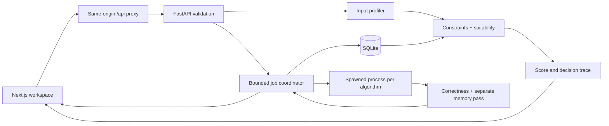

# Architecture

## Request and execution flow

The Next.js root layout keeps a single workspace context alive across pages. Input changes invalidate the selected result; active benchmarks prevent edits. Selection requests use revisions so a stale response cannot overwrite a later decision. Benchmark polling is independent of page navigation.

FastAPI routes validate requests and call domain services. The profiler is separate from timing. A selection result preserves candidate eligibility, exclusions, metadata, heuristic work, four normalized components and final score. The benchmark freezes that selection before execution, so later history cannot retroactively alter the prediction.

Workers receive only serialized input. Python's spawn context gives each algorithm a fresh process on Windows as well as other platforms. A unidirectional pipe delivers bounded output after full correctness verification. The coordinator receives data before joining to avoid pipe-buffer deadlocks, terminates timeouts, and records partial failure statuses explicitly. Two jobs maximum; algorithms within one job run sequentially. A restart loses live job state, while completed SQLite experiments survive.

## Database relations

- `experiments`: ID, UTC timestamp, domain, prediction, actual winner, gap, baseline and selected times, match status, immutable selection JSON.
- `dataset_profiles`: one-to-one profile JSON, flexible across sorting/searching/graph domains.
- `algorithm_results`: many-to-one candidate scores, median times, operation totals, Python allocation peaks, status, full result metadata including bounded preview.
- `benchmark_runs`: individual trial number and duration per algorithm/experiment.

Foreign keys are enabled; writes use a transaction. WAL mode supports readers while a job is recorded. Connections are short-lived and scoped to operations. The default path is relative to the backend source location. Test databases are temporary and separate from the application database.

## Design boundaries

The dashboard begins empty and uses only pasted/uploaded input. Reference curves are explicitly theoretical. The visual sequence is input signature → profile → contenders → recommendation → measured winner → evidence. Orange identifies actions and the measured winner; subdued colors compare alternatives. Graph layouts are visual geometry, not algorithm output; highlighted paths and distances come only from completed Python execution.

No user accounts or deployment service is configured; servers bind to loopback. The app is intended for local college demonstrations. Production deployment would need authentication, centralized durable job state, larger operational limits and monitoring.

## Visual execution

`POST /api/{domain}/trace/{algorithm}` checks input limits and eligibility, then executes the same implementation used by benchmark workers. An optional observer on Metrics receives explicit semantic events from the algorithms. It stores bounded deep-copy snapshots, then verifies the full output using the independent benchmark oracle. Snapshot construction is guarded by the observer so normal benchmarks do not build trace arrays or distance dictionaries.

The client player presents those frames with array bars or a graph and distance matrix. It supports play/pause, previous/next, restart, speed, and scrubbing. The input/algorithm key resets playback and pending input hides stale frames. Input is never silently sampled. Limits are 80 values, 8 queries, or 16 nodes / 60 edges; at most 4,000 frames are returned, with omitted intermediate frames disclosed. Playback does not write adaptive history or report its animation duration as runtime.

The generator endpoint and generator implementation were removed. Empirical experiments require actual input data and sizes within that data; workers execute prefixes without generating or reordering them.
